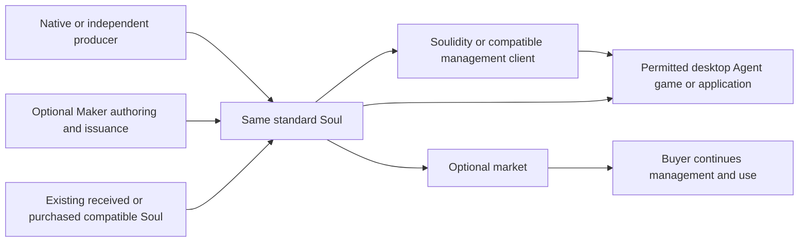

# Soulidity Whitepaper

Version 0.3 Draft · October 17, 2026  
[Project overview](README.md) · [Implementation status](IMPLEMENTATION_STATUS_20261017.md)

This paper defines the project's direction, product relationships and delivery requirements. Target architecture, implementation, independent acceptance and release are separate. Availability follows the implementation status and release records for the exact version.

Read the [journey and composability specification](JOURNEYS_AND_COMPOSABILITY.md) for all 37 retained journey checkpoints, the ten modules and fifteen maintenance units, interface families, integration recipes and compatibility requirements. The [review record](WHITEPAPER_REVIEW_20261017.md) explains this revision and remaining evidence gaps. Publishing this draft does not release a protocol or deploy a product.

## 1 Project summary

Soulidity is an open creation and use ecosystem for original characters, digital characters and AI entities. Persistent Soul identity provides a common foundation for content, permissions, components, transactions and applications connected through public, composable protocols.

Users can create a Soul directly, receive an existing Soul, use an independent producer, or compose a character through a Maker. They can then use Soulidity or a compatible client to manage content, assemble appearances, grant access and enter desktop, Agent, game or other experiences. Journeys have independent entrances and resumable boundaries; tools can be replaced within their declared version and permission support.

The architecture centers on modularity, an internal ecosystem of cooperating products, and open interoperability. First-party products consume the same public contracts available to third parties. Standard does not depend on a platform market, channel or community. Services govern their own rules and state; clients do not receive universal control of user assets.

The long-term direction is **Create Once. Live Across Worlds.** Identity, provenance and the content and history allowed by explicit rules can continue. Applications retain their own rules, and cross-application use requires integration and acceptance evidence.

## 2 Users and problems

When characters cross creation, trading and usage tools, their images, lore, persona, memory, skills and records need coordinated maintenance. Creators manage assets, versions and licenses. Holders distinguish what they own, may use and may transfer. Developers need reliable identity and scoped permissions. These relationships must survive interruptions, transfers and changes of tool.

| Participant | Need | Project outcome |
| --- | --- | --- |
| OC creators, asset authors and external AI Agent creators | Author, reuse, publish and maintain work and its rights | Editable projects, explicit releases, provenance and economic relationships |
| Character holders and users | Create, collect, manage, assemble, authorize and use characters | Verifiable assets, content, rights and operation results |
| Application, runtime and game developers | Read identity, consume permitted content, extend capabilities and record results | Optional public interfaces, SDKs, compatibility documentation and examples |
| Independent service providers | Offer editing, storage access, distribution, markets and other services | Scoped service contracts without ecosystem-wide administrative power |

An ordinary OC does not need to become an autonomous Agent to benefit from content management or authorization. External Agent creators are users; internal development Agents, internal trials and actual external adoption are measured separately.

Value is demonstrated when users can create, reopen, authorize, hand over and use their characters across supported environments, and when developers can integrate independently. Code volume, transaction volume and internal demonstration counts do not establish those outcomes.

### 2.1 Research scope and existing approaches

Research starts with products for character creation, collection, lore, presentation, handover and use, then examines composable assets, Agent content, licensing and application infrastructure. Maker platforms and character repositories serve different stages; their creator supply, player experience, saved objects and rights require separate analysis.

#### 2.1.1 Maker platforms: creators build tools, players compose characters

**Picrew** connects authors who build playable Image Makers with players who combine parts and colors. Its documentation describes Parts, Items, Layers, colors and creator-limited adjustments. Authoring therefore involves composition rules and testing as well as illustration. [I01][I01] Playing, downloading and social sharing have a baseline permission scope; personal, non-commercial, commercial and modification permissions have additional rules. A successful download does not establish permission for every later use. [I02][I02]

**NEKA** also connects template authors and character-making players. Its official creator notice documents paid DLC, modification licenses and creator income. Modification permission is neither a buyout nor commercial permission; proposed whole-template paid play cannot be presented as an already available feature. Playing, buying expansions, obtaining modification permission and acquiring full rights are distinct relationships. [I04][I04]

**Meiker.io** illustrates a production choice: labeled PSD layers express required or optional selections for players. Import, naming and bulk configuration are part of reducing creator effort. [I05][I05]

A Maker is a two-sided product: its author supplies a reusable creative system, and players express characters within that system. Research measures authoring effort, player completion, discovery, attribution and return use separately rather than counting exported images alone.

#### 2.1.2 Toyhouse: character records, creator relationships and handover

**Toyhouse** provides a reference for life after character creation. Its official FAQ distinguishes Owner, Creator and Designer, tradeability categories, and privacy versus listing. Character management encompasses continuing information and participant relationships rather than only an avatar image. [I06][I06]

Its rules require attribution for characters and artwork and verification of the specific generator's upload and trading permissions for doll-maker outputs. Provenance and permissions matter when a generated image becomes a maintained or transferred character. [I07][I07]

Soulidity therefore distinguishes designers, illustrators, current asset holders and permitted users. Toyhouse permissions are not this project's three component modes or automatic onchain authority. Its current rules also restrict AI-generated content; human-art OC communities and Agent users need separate research rather than assumed shared adoption. [I07][I07]

#### 2.1.3 From existing products to project research questions

| Product layer | Reference and user value | Soulidity / Animacraft design task |
| --- | --- | --- |
| Playable creation templates | Picrew and NEKA: authors supply rules and assets; players compose quickly | Separate authoring and Player; allow local completion and continuation without mandatory issuance |
| Production and project exchange | Meiker and Krita: layers, bulk preparation and interchange | Preserve assets, rules, IDs and versions; verify round trips separately from publication |
| Expansion and permission products | NEKA DLC/modification and Picrew usage scopes | Distinguish Maker qualifications, Packs, components, generation policies and licenses with accurate quotes and retained rights |
| Character records and handover | Toyhouse: profiles, credits, privacy and trade conditions | Maintain one Soul's content, provenance, versions and scoped authority; explain exactly what transfers |
| Subsequent applications | Desktop, interaction, Agents and games serve different needs | Connect public modules through explicit adapters; preserve identity and effective rules across tools |

The final column contains project proposals and validation tasks. It does not assert that reference platforms lack all these capabilities or that integrations with them exist. Protocol research supplies additional references:

| Direction | Primary-source mechanism | Project research question |
| --- | --- | --- |
| Open authoring formats | Krita describes OpenRaster as an interchange format containing XML and PNG layers. [R01][R01] | How should an exchanged project become a fixed release with assets, rules and rights? |
| Components and nesting | ERC-6220 specifies fixed and equippable slot parts; ERC-7401 specifies parent-child NFT relationships. [R02][R02], [R03][R03] | How do reference, permanently bound and independent components connect to editing, rendering, sale and recovery? |
| Asset-owned accounts | ERC-6551 describes NFT-controlled accounts and their interfaces. [R04][R04] | What assets and permissions does a buyer receive, and how is post-quote composition drift rejected? |
| IP and licensing | Story interfaces distinguish license terms, license tokens and asset registration. [R05][R05] | How are custody, access, licenses and income explained separately and enforced in operations? |
| Agent memory | OpenClaw documents persistent workspace memory and its use. [R06][R06] | Which character content should travel, which runtime or personal data should remain local, and how can access be granted without moving wallet or service credentials? |
| Onchain frameworks | MUD combines storage, synchronization, access control and developer tools. [R07][R07] | How does common identity enter different applications while preserving independent rules without one mandatory engine? |

These sources establish existing research and mechanisms. They do not imply implementation compatibility, code inheritance or feature parity, nor support claims that the industry lacks solutions or that Soulidity is globally first. The project's value must be demonstrated by usable, replaceable lifecycle composition with clear rights.

### 2.2 Priority problems

**Identity and content continuity.** Changing clients should not require recreating a character or manually reconstructing all versions. Shared identity, exact content and verifiable provenance must support entry with an existing asset.

**Confused rights.** Buying a character, reading content, owning a tradable component, controlling its source Maker and holding copyright permissions are different relationships. Products explain the scope before an action; actual entry points enforce it.

**Composition versus obligations.** Developers want extensibility while assets may carry financial, privacy or transfer obligations. The project distinguishes extensions that a fixed consumer can carry transparently from effects requiring adaptation or rejection.

**Interrupted multi-stage operations.** Authoring, upload, certification, publication, qualification and final issuance have different results. Closure, network errors or uncertain transactions must preserve original work, assets and paid resources.

**Useful life after creation.** A tradable identity alone does not establish value. Management, desktop use, Agent interaction or gameplay needs an actual usable experience and evidence of continued use.

Project code, historical defects and received materials locate concrete engineering problems. They do not establish industry-wide incidence, market size or willingness to pay. OC and Agent users may share mechanisms while their needs, costs and purchasing behavior require separate study.

### 2.3 From problems to engineering

| Problem | Product behavior | Engineering mechanism | Acceptance |
| --- | --- | --- | --- |
| Identity/version loss across tools | Enter with an existing Soul and continue | Network, type origin, root ID, content commitment and versioned reads | Alternative client recognizes the same asset; missing resources and unsupported versions are explicit |
| One vague ownership label | Show custody, access, component, license and management scope separately | Three rights modes, scoped authority, actual custody proofs and exact supply/income authority | Wrong subject, instance, expiry or domain rejected; legal exits retained |
| Extensions force unrelated upgrades | Select capabilities; degrade unknown display safely | Minimal Standard, namespaces, seven dependency kinds and declared effects | Frozen market baselines survive passive extensions; active obligations cannot be skipped |
| Repeated payment or lost work | Show completed work and the next legal step | Fixed snapshot, durable intent, original-digest query, receipts and concurrency control | Network loss, reload, multiple tabs and a new client resume the same operation |
| Composition exists only in a picture | Assemble, save and sell actual assets | Child objects, recipes, licenses, versions and atomic delivery | Buyer can continue assembly; Free keeps its ID and Bound remains with its Soul |
| No continuing use | Enter a permitted experience after management | Runtime/application adapters, scoped grants and authentic outcome authority | Actual runtime use, reopening and exits; simulations do not become real history |

### 2.4 Product operation

Entry first establishes the asset or producer, then verifies versions, actual custody and current action authority. Management displays exact content and composition. Empty equipment, missing resources and protected-read failure have distinct states.

A mutation explains the objects, rights, fees and expected result, then constructs a constrained action for confirmation. Receipts and authoritative readback establish the outcome; uncertainty queries the original operation. The next client verifies its own prerequisites rather than trusting an earlier page's success label.

Users can stop at a useful result: save without publishing, publish without a channel, manage and use without selling, or trade without joining a community. Different producers, markets and applications retain common identity and effective asset obligations.

### 2.5 Demand and adoption research

Study creators, holders, Agent operators and independent developers separately. Observe existing workflows, then compare the same task with a candidate product. Record time, errors, support, rights comprehension, recovery, complete costs, repeated use and integration effort with samples, versions, tasks and failures. Internal tests do not replace user research.

Test whether independent entrances reduce onboarding burden, clear rights reduce mistakes, durable recovery reduces duplicate operations and loss, and public modules reduce integration and upgrade effort. Do not invent improvement percentages; revise mechanisms or products when hypotheses fail.

Local tools can handle tasks that only need single-device editing or organization. Onchain mechanisms serve identity, custody, authorization, issuance and settlement that multiple parties need to verify; every edit or inference need not become a transaction.

## 3 Core entities and rights

A Soul is the root of persistent identity and actual ownership. A Maker is a reusable creation definition and producer asset. Its editable project, fixed release and onchain control are distinct. Creator means the author; Maker means the playable definition; Player means the interface consuming it. A Pack supplies versioned expansion content. A Runtime executes interactions and tasks; a Scene or application defines the environment and rules.

### 3.1 From Maker projects to character records

Animacraft retains **Maker → Part → Item → Style**: a selectable part, its options and their specific styles/resources. Layers, colors and permitted adjustments determine the image. Compatibility follows actual schemas and versions; similar terminology does not establish direct support for Picrew, NEKA or Meiker projects.

| Object | Preserves | Distinct outcome |
| --- | --- | --- |
| Maker project | Author assets, structure, rules, resource IDs and edit state | A player image does not contain the complete editable source project |
| Maker/Pack release | Fixed definition, content and rights basis | Later draft edits do not silently replace a published version |
| Player recipe | Exact versions, selections and permitted adjustments | Saving a recipe does not prove purchase, custody or issuance eligibility |
| Outputs | Results for defined portrait, full-body or other output configurations | Exporting an image creates no automatic Soul, component asset or copyright transfer |
| Soul | Persistent identity, custody and a root for selected extensions | Direct creation or receipt works without a Maker |
| Character record | Lore, references, forms, credits, relationships and version links | Profile entries, source assertions and verified asset facts remain distinguishable |
| Runtime instance | A particular desktop, Agent or game configuration and execution state | Common identity does not share every memory, permission or runtime state |

A character record is a continuing management view; content and extension modules maintain its constituent information. Field availability follows the actual release. A text-based OC can precede its first illustration and never become an Agent.

### 3.2 Custody, use and component rights

Identity, content bytes and runtime instances have separate lifecycles. Persistent identity does not imply perpetual storage or a permanently running Agent. Ownership, content access, asset licenses, publication, distribution, income and package upgrades are distinct rights.

| Component mode | Meaning | Removal and handover |
| --- | --- | --- |
| REFERENCE | An exact content, fixed Style and license reference | Clearing a selection creates no asset; source Maker, Pack and seller-specific qualifications are not transferred |
| SOUL_BOUND | A permanent record bound to a particular Soul | It can be removed from the image, but remains with that Soul and cannot be sold independently or moved to another Soul |
| TRANSFERABLE | A real independent component instance created under issuance rules | Legitimate removal preserves its ID; installed components follow the whole-asset sale rules |

Each Part selects at most one fixed-Style content unit. Permitted color and layout adjustments do not rewrite component provenance. Display recipes, qualifications and wallet inventory are read separately; images and snapshots do not prove custody.

Issuance, assembly, sale, authorization and recovery preserve the relationships between roots, child assets, bound records and references. Purchased rights, supply counters and earned income follow their effective rules rather than being reset or duplicated by a new client, channel or controller. Supported nesting also declares real parent/child custody, root access, transfer effects and exits; metadata alone cannot establish them. The project does not promise arbitrary nesting depth or automatic compatibility with every external container.

## 4 Journeys with independent entrances

Delivery is organized around useful, independently completable journeys. Each has an input, a valid result, next-step conditions and a recovery route. Users can enter in the middle and stop after obtaining a result.

The common lifecycle is **create or receive a Soul → manage content, components and permissions → use it in an authorized application → retain valid results and continue maintenance.**

This diagram shows target journeys, not deployed interfaces or package dependencies.

### 4.1 Independent entrances

- Native creation enters management and use without Animacraft.
- An existing, received or purchased compatible Soul enters supported management or use without reissuance.
- An independent producer creates a standard Soul and joins the same downstream capabilities.
- Maker, Pack and component composition produces a Soul that joins the common lifecycle.
- A compatible third-party client can manage and use an asset without first visiting Soulidity App.

### 4.2 Independently useful journeys

| Journey | Input | Result | Optional continuation |
| --- | --- | --- | --- |
| Author a Maker | Assets, rules and creative content | An editable, previewable, exportable and reopenable project | Continue editing or hand it to a publisher |
| Publish a Maker or Pack | A fixed snapshot, valid assets and issuance conditions | A verifiable version satisfying its availability conditions | Use directly or choose a channel |
| Generate a character | Valid definitions, qualifications, recipe and quote | One Soul with accurate component rights | Manage, use or trade |
| Create or receive a Soul | Native inputs or a compatible existing asset | Correct identity, provenance and custody | Manage or use directly |
| Manage content | A Soul and permission for the action | Traceable content references and versions | Display, authorize or run |
| Manage appearance | Legitimate components, recipe and adapters | A saved, recoverable composition | Use, separate or trade |
| Authorize or purchase access | Content, subject, scope and terms | Verifiable access or operation entitlement | Consume it in a permitted application |
| Trade and hand over | A tradable asset, quote and participants | Correct payment, rights and asset delivery | Buyer continues management and use |
| Desktop and Agent use | A Soul, permitted content and runtime settings | An actual running instance | Continue or replace the compatible runtime |
| Game or application use | Identity and capabilities satisfying local rules | A valid experience and applicable result records | Return to management or another application |
| Community and discovery | A user, content or display requirement | Useful communication and discovery | Choose creation, trading or an experience |

Authoring, storage, onchain publication, channel enrollment and final issuance complete separately. Saving a local project is useful in itself. A Maker root is not proof of a usable version. Market use does not require community participation, and managing a Soul does not require selling it.

### 4.3 Three concrete workflows

**Asset author.** An illustrator prepares a character base, hairstyles and clothing, configures layers, colors, compatibility and licenses, tests combinations in Player, and saves an exportable, reopenable project. Publication fixes a version and explains the base Maker, expansion scope, qualifications and fees. The author can maintain releases, select distribution or stop at local authoring. Transferring Maker control is separate from selling a generated character.

**Player and character holder.** A user discovers a Maker available for preview, tries selections, colors and outputs, and may stop with an image and recipe. Optional issuance verifies the exact release, qualifications, fees and component rights. The resulting Soul joins a character record with lore, reference images and permitted relationships. Expansion, desktop use and buyer handover continue with the same asset and effective rules. Unsupported actions are explicit; preview success does not become issuance success.

**Existing OC or independent developer.** A user enters management with their own lore, legitimate references or an existing compatible Soul without first finding a Maker. A developer may build only an editor, Player, repository client or application using selected public modules. External content requires actual permission; a source URL alone does not prove custody, license or copyright.

All three paths allow stopping, resuming and tool replacement. Cross-Maker, cross-style and cross-application composition needs declared adapters. Common identity does not make arbitrary clothing, body proportions or output layouts compatible.

### 4.4 Independent service, maintenance and exit journeys

A complete lifecycle also includes publishing a new Maker/Pack version, distributing under a chosen channel agreement, collecting earned income, renewing content, granting and revoking scoped access, redeeming an applicable Physical voucher, maintaining Collections and community data, and leaving or replacing a service. Each has its own prerequisites, authority, result and recovery route. None becomes a compulsory step for an unrelated Soul user.

Creator entry verifies the active identity without confusing a login signature with a spending approval. Account changes invalidate stale UI assumptions. Discovery and permitted local preview can precede a wallet; a privileged action checks the actual signer and asset authority. Existing Souls enter management or supported use directly, including when their content is temporarily unavailable. A read failure does not authorize minting a replacement identity.

The [complete checkpoint catalog](JOURNEYS_AND_COMPOSABILITY.md#retained-journey-checkpoints) preserves J01–J37 as coverage identifiers. They do not impose one mandatory chronological funnel. Recovery begins with the first saved project or transaction and accompanies every branch, rather than being deferred until launch.

## 5 Continuation and tool replacement

A continuation boundary identifies the real network, type origin, asset ID, version, necessary content and current authority. In-flight work also retains the original intent, transaction digest, successful receipts, paid resources and next legal action. File identifiers do not impersonate onchain IDs; a local completion flag is not chain evidence.

Users can export a project and change publishing tools, resume management on another device, or continue original asset operations through a compatible client when a service exits. Continuation depends on public infrastructure, available content and actual rights rather than a remembered sequence of platform clicks.

Signing, submission, execution success and business readback are distinct. Unknown results query the original transaction. Successful execution followed by temporarily unavailable readback remains successful; it does not authorize another payment, mint or replacement transaction. Concurrent tabs, account changes, permissions, older versions and unsupported containers require explicit behavior.

Handover includes only the required project and recovery information. Private keys, seed phrases, keystores, access tokens and browser credentials are excluded. A local draft without an export or backup cannot be promised automatic recovery after device loss.

Replacing a client continues operations on the same service instance and its original state. Selecting a new market, channel, content-policy instance or runtime does not inherit the former instance's orders, grants, quotas, balances or capabilities. A migration requires its own explicit mapping, rights checks, treatment of in-flight obligations and acceptance; choosing a fresh service is a separate action.

The continuation record fixes the selected network, type origin, schema, service instance, content manifest, original intent and successful receipts. Encrypted recovery material can contain sensitive drafts or valid signed payloads and needs access protection even though it contains no wallet secrets. Recovery preserves exact uploaded ciphertext where it is already bound to the operation. A new attempt is allowed only after resolving the prior attempt under the actual transaction rules; a timeout alone is insufficient.

## 6 Modularity and the internal ecosystem

Modules follow independent rules, authoritative state and maintenance responsibility. Each declares responsibility, public interfaces, actual dependencies, its sole implementation and release boundary, errors and recovery, consumers and acceptance evidence. Repositories, maintenance units, onchain packages and upgrade authority are registered separately.

| Module | Responsibility | Boundary |
| --- | --- | --- |
| Standard | Soul identity, provenance, root and minimal capability contracts | No reverse dependency on Maker, Market, Channel, Community or global business configuration |
| Content | References, access, storage lifecycle and recovery | No asset-transfer or arbitrary spending authority |
| Maker | Definitions, versions, Packs, qualifications, supply and issuance adapters | Core does not require Soul; Soul-producing paths use an explicit adapter |
| Channel | Scoped delegation, authorization and distribution | Its terms, quotas and income; no duplicate asset supply |
| Market | Orders, quotes, custody, cancellation, delivery and settlement | No compulsory channel; actual asset obligations remain enforceable |
| Extensions | Optional components, visuals, history and other capabilities | Independent namespaces, write authority, state and effects |
| Community | Profiles, posts, comments, relationships and pagination | Moderation is not asset control or issuance permission |
| SDK | Optional reads, transaction builders, errors and recovery | No authoritative business ledger or wallet keys; no mandatory all-business bundle |
| DevOps | Pinned build, delivery and operational tools | No mandatory business runtime dependency or universal signer |
| Integration | Exact-version interoperability and takeover verification | Evidence, not ecosystem admission or business permission |

Fifteen retained maintenance units cover the editor, publisher, Native producer, asset policy, package governance, historical lineage, Soulidity Web, SoulDesk, Engine, four games, documentation and external interfaces. Their responsibilities remain part of the full project.

First-party products also consume public contracts. Maintainers write only their own authoritative implementation; consumers do not rely on private witnesses, internal mutable references or undeclared global configuration.

Compile, runtime, behavior, authority, funds, state and content dependencies are recorded separately. Stable signatures do not establish behavioral or financial compatibility. Separate directories do not establish separate upgrades. Revalidating an affected combination does not automatically require republishing an unaffected consumer.

### 6.1 Module contracts and dependency direction

Each release identifies its owning source, public types and schemas, required interface families, version constraints, network/type origins, state authority, custody assumptions, declared effects, errors, recovery, upgrade control and licensing. A capability description is an inventory of behavior, not permission to perform that behavior. Domain entry points validate their own proofs and consume one-time obligations exactly once; an ordinary historical receipt is not reusable authorization.

Standard remains the minimum shared identity and safe-root contract. Maker core and generic Content can be useful without a Soul; a selected Soul adapter connects their relevant paths. Market core connects to asset-maintained transfer/settlement adapters rather than importing every game, extension or channel. Channel governs its own agreements and distribution outcomes; it is independently usable and not a mandatory market gate. Community never becomes an asset-creation authority.

SDK provides nine optional capability groups: standard reads, root operations, Maker publication, issuance, content, community, market, channel and extension adapters. Internal products use the same supported public surfaces as external consumers. Integration records version combinations and evidence; DevOps supplies pinned tools. Neither is a user-transaction approval service.

Sixteen semantic interface families and the retained maintenance units are listed in the [companion specification](JOURNEYS_AND_COMPOSABILITY.md#interface-families). These are design contracts; exact ABI, object types and deployment identities must be frozen and tested for each release. One repository can contain multiple packages, and one package can share an upgrade authority across several modules. Directory separation alone provides no independent upgrade guarantee.

## 7 Third-party extensions and interoperability

Developers can independently select Standard, Content, Market, Channel, extensions or SDK subpackages. Platform registration is not permission to create a standard asset. No developer is required to adopt the entire ecosystem or one common game engine.

A passive appearance or history extension maintains its own namespace and state. The primary compatibility test freezes a coherent target market's source, lockfile, configuration and artifact, then introduces an independent passive extension. The same Soul must still list, cancel and sell, with zero forced market releases.

Active capabilities and effects involving funds, authorization, supply, transfer, private handover or exits require appropriate adaptation or explicit rejection. Unknown extensions receive no automatic execution rights. Self-reported fields do not establish authority; unrestricted transfers do not automatically run market royalty or revocation hooks.

Public contracts require versions, schemas and types, success and error examples, support matrices and recovery instructions. Actual independent implementations and operations establish external integration. Internal examples and successful compilation remain narrower evidence.

### 7.1 Composition available to independent builders

A third party may implement a producer, editor, Player, character repository, market, channel, extension or application, using only the contracts its selected operations require. For example, an independent producer can issue a compatible Soul without Animacraft; a repository can read Standard and selected Content without trading; a market can settle compatible assets without Channel; a game can read identity and write its own authentic results without adopting Infinite Flow Engine. The [integration recipes](JOURNEYS_AND_COMPOSABILITY.md#composition-recipes) identify the authority and handoff boundary for each.

Permissionless protocol access means no mandatory Soulidity registration, team signature or proprietary backend approval for an otherwise legitimate public operation. Asset rules, selected service terms, content availability and network execution requirements still apply. Referencing a public endpoint does not waive its operational conditions.

### 7.2 Compatibility and independent release acceptance

Each extension declares read, write, carry and handover behavior, plus effects on funds, authority, supply, custody/transfer, content and exits/history. Unknown optional display data may be ignored or degraded; unknown mandatory obligations cause rejection. A renderer must not silently substitute missing artwork or claim an unsupported appearance is faithful.

Compatibility checks fix source, locks, configuration and artifacts. They cover baseline/current, candidate/current and candidate/candidate provider-consumer combinations, plus reverse combinations where real dependencies require them. Wrong type origins, manifests, hashes, policy generations and unsupported schemas are negative cases. Independent change that preserves a consumer's actual contracts requires zero forced changes to that consumer's four fixed artifacts; validation can propagate without publication propagating.

Visual acceptance retains two legitimate Maker projects with different canvas configurations across three actual consumer classes, including real rendering and consistent numeric behavior. Multiple local rendering paths are narrower evidence and cannot be relabeled independent products. Historical Makers or goldens need not be found before establishing legitimate new baselines.

A release must publish its supported producer, custody, schema, content, renderer and application combinations. Local tests are not third-party adoption: an independently implemented producer and alternative client must operate the same supported asset, and platform-specific services must be removable within the declared infrastructure assumptions.

### 7.3 Code, content and service licenses

Each released module and SDK states its actual code license and distribution terms. A public repository or open interface alone is not a grant to reuse all source, artwork, trademarks or hosted services. Content licenses, contributor attribution, generated-image permissions and asset-transfer rights are separate records. External-platform content requires specific authorization; the project does not promise automatic Picrew, NEKA or Toyhouse import compatibility.

## 8 Products and acceptance

| Product area | User outcome | Acceptance |
| --- | --- | --- |
| Soulidity Protocol and workspace | Create or receive Souls; manage content, components, permissions and supported transactions | Same-asset identity and usable normal, error, cancellation and cold-recovery paths |
| Animacraft | Author Makers, preview Player, export Outputs, publish and optionally distribute | Faithful project round trips, usable fixed versions, correct qualifications and issuance, recoverable work |
| Content and authorization | Public or protected content, versions, access and maintenance | Integrity, lifecycle, permission and actual reads agree; invalid roles are rejected |
| Components and visuals | Three rights modes, assembly, adapters, adjustments, Loadouts and display | Actual IDs and recipes agree; evidence for supported canvases and clients |
| Market and Channel | Voluntary distribution, transactions and services | Terms, quotes, payment, delivery, income and legitimate exits agree |
| Community and discovery | Profiles, communication, relationships and discovery | Existing author, pagination and editing behavior works without becoming an asset gate |
| SoulDesk | Desktop characters, persona resources and Agent workflows | Permitted reads, scoped permissions and budgets, restart and update recovery |
| Infinite Flow Engine | Scenes, Runs, rules, settlement and outcomes | Declared interfaces, authority, authentic results and exits verified |
| Each game | Independent experiences and rules | Playability, tutorial versus real execution, settlement and identity integration verified by version |
| Developer and operational tools | Documentation, SDKs, examples, builds and recovery | Clean-environment reproduction, optional integration and accountable release and operation |

Soul Expedition, Soul Paper Theater, Infinite Stellar and Soul Habitat maintain independent state and economic rules. Shared Soul identity does not transfer every inventory, combat advantage or seasonal position. Each game is delivered against its confirmed scope; planning, simulation, testnet and production remain distinct.

### 8.1 Animacraft author and player experiences

Authoring covers asset import, parts and styles, layers and colors, permitted adjustments, multiple output configurations, publication checks, reopenable projects and release maintenance. Preview must expose missing resources, occlusion, anchor and canvas faults; one attractive default is insufficient acceptance. Authors, contributors, licenses and versions remain traceable. Buying generation eligibility does not automatically deliver source assets.

The player experience covers discovery, understanding a Maker, selection and random exploration, permitted adjustments, recipe saving, outputs and optional issuance. Free and paid content are explicit, and quotes identify the actual product. Permitted preview and local creation should provide early value; signatures and payment belong where authoritative changes require them. This does not require every Maker or Pack to be free.

Base Makers, Expansion Packs, independent component assets and image outputs are managed separately. Pack compatibility and actual selected content are visible; purchasing a Pack does not turn every entry into a tradable asset. Contributions, provenance and income follow their applicable policies and verified paths.

### 8.2 Soulidity character records and continuing management

The workspace presents a character's lore, references and forms, credits, actual custody, appearance, components, permissions and applicable history. Public, protected and local-only information have distinct treatment. Relationships and worldbuilding do not need to become financial assets, and fictional lore does not impersonate actual game outcomes.

Before handover, identify the Soul, real child assets, bound records, references and usable content, alongside personal qualifications, private information and runtime credentials that do not transfer. The recipient's ability to reopen and continue management is stronger completion evidence than an order success label.

| Acceptance task | Required user result |
| --- | --- |
| Author and reuse | Configuration, preview, export and reopen preserve versioned structure and appearance; invalid combinations are discoverable |
| Compose and resume | Restore exact recipes, sources and the next legal action across pages/devices without duplicate purchase or issuance |
| Pay and expand | Maker, Pack, generation policy and component rights are explicit; updates do not silently reset purchased rights |
| Maintain records | Separate creators, artwork sources, holders and verified evidence; visibility and edit permissions work |
| Trade and receive | Buyer receives promised assets and applicable content and can reopen, manage and use them legitimately |
| Integrate independently | Alternative editors/repository clients consume public contracts; incompatible content is rejected or explicitly degraded |

These are delivery requirements, not claims of current implementation or integrations with reference platforms.

### 8.3 Collections, Physical products and service operations

Collections retain their actual membership, management, access and applicable purchase rules. A display folder or social grouping is not automatically a collection-right asset, shared asset controller or entitlement to its members. Where an existing transferable CollectionRight is supported, its own type, policy, membership and delivery semantics must be verified explicitly.

Physical issuance remains an independent product branch with its original free, paid, voucher, supply and consume behavior. Products explain what is consumed, whether the action is irreversible, and which evidence establishes completion. A voucher, chain event or artwork reference does not establish external manufacturing, shipment or legal title to a physical item. Last-unit concurrency, double redemption, incorrect roles, failure and unknown execution require tests.

Channel selection, revocation and re-acceptance identify exact agreements, actions, terms, versions, limits and beneficiaries. Ending an agreement does not erase already valid purchases, earned income or obligations; future consent and old obligations follow their original rules. An unaccepted quote is not an already paid obligation. Reserved, fulfilled and uncertain operations follow their exact bound terms and receipts. Revenue claims bind the actual entitled control and ledger, currency, precision and accounting basis rather than a cached creator address.

### 8.4 Applications, games and future authoring tools

SoulDesk connects permitted appearance/persona content to desktop presentation and Agent workflows. Infinite Flow Engine provides selected scene/run/settlement capabilities; SessionAdapter is an independent package within that project. Soul Expedition, Soul Paper Theater, Infinite Stellar and Soul Habitat retain separate product goals and state. Supported onchain results require authentic application authority and replay protection. Tutorials and simulations remain separate from real history and reward entitlement.

Character creation, records and appearance management are useful without autonomous Agents or games. Future Scene Maker, game templates, activity builders and wider networks remain separately specified directions. Their presence in historical vision documents does not turn them into delivered modules or prerequisites for the common Soul lifecycle. Historical OCL-0 to OCL-5 capability vocabulary describes a possible maturity model, not financial value or a universal autonomy ranking; adopting it requires its own measurable specification and product evidence.

## 9 Why build on Sui

### 9.1 Technical fit

The project needs an asset-centered foundation with real ownership and composable rights and transactions. Sui and Move carry authoritative state; Walrus carries large files; Seal is optional protected access; clients and runtimes perform editing, rendering and inference.

| Layer | Project requirement |
| --- | --- |
| Sui and Move | Identity, ownership, component relationships, authority, supply and atomic business results |
| Walrus | Retrievable, verifiable images, projects, documents, content packages and ciphertext |
| Seal | Protected reads linked to particular onchain policies |
| Clients and runtimes | Authoring, display, interaction, AI execution and recovery |
| Query and indexing tools | Discovery and experience improvements; sensitive actions still verify authoritative state |

### 9.2 Object-centered characters

Sui objects have IDs, types, ownership and versions. Souls, real components and control capabilities can therefore express their own identities and relationships throughout assembly, transfer and cross-client reads. This fit with the project's asset model is a central reason for choosing Sui. [T01][T01]

The Sui Lutris paper provides historical research on objects and hybrid transaction processing. This paper cites a fixed version; selected software and current documentation determine actual interfaces and execution. Its experiments are not Soulidity throughput or latency measurements. [P01][P01]

Move's resource and type constraints support explicit asset and capability contracts. The project uses typed components, issuance proofs and control objects rather than treating every right as ordinary metadata. Correct implementation and adversarial validation remain necessary. [T02][T02]

Dynamic fields and dynamic object fields accommodate heterogeneous extensions and child objects around a stable root. Passive extensions can evolve without repeatedly enlarging the root layout. Parent-mediated child access must be reflected in interfaces; storage composition alone does not isolate authority. [T03][T03]

Programmable transaction blocks compose public operations atomically. Applicable issuance checks, counters, payments, component creation and final delivery can succeed or fail together. Walrus uploads and other cross-system steps retain separate recovery boundaries. [T04][T04]

Explicit object inputs also support scheduling non-conflicting work in parallel. Separate user roots and service state avoid an unnecessary ecosystem-wide mutable bottleneck. Shared counters and popular services can still contend; actual load requires measurement. [T02][T02]

These features support the intended building blocks. They do not automatically deliver arbitrary extension compatibility, unlimited concurrency or safe authorization. Public ABI, custody, versioning and governance remain project responsibilities.

### 9.3 Why Walrus

Images, layers, projects, persona documents and evolving content require substantial file storage. Onchain references and commitments connect assets to Walrus files so compatible clients can verify the same released content without placing all media inside a Soul object.

Walrus uses erasure coding for distributed storage, reducing full-replication overhead while supporting recovery and storage-node changes. That design fits asset-heavy applications; upload, retrieval and maintenance costs still require project measurements. [T07][T07]

The Walrus research paper examines RedStuff coding, recovery and storage-node churn. It supports the technical rationale; its model, design and deployment assumptions remain distinct from project costs or availability guarantees. [P02][P02]

Availability certification is observable on Sui, connecting an asset to required content. A content hash establishes byte integrity; availability and expiry establish whether those bytes remain obtainable. They are separate checks. [T08][T08]

Quilts support packaging many small resources with item-level retrieval. Makers can organize a version's resources with their exact identifiers and digests, reducing small-file management overhead. Actual certification, handover and cost improvements must be validated in the publishing path. [T09][T09]

Storage is not permanent at zero cost. Certification, retention, renewal and deletion are managed per resource. Deleting a storage record does not erase previously obtained copies. [T10][T10]

### 9.4 Why optional Seal

Some character content is public; other content requires an owner, grantee or valid buyer. Seal links decryption-key access to application policies on Sui. Actual roles, policies and key services need verification. [T06][T06]

Public paths do not require the private subsystem. Protected bytes are encrypted before upload. Revocation cannot retrieve already saved plaintext. Key-service trust, availability and versions remain explicit dependencies. Wallet private keys and seed phrases are not stored as character content or in Seal.

### 9.5 Engineering costs and limits

The stack still requires contention control, object and transaction budgets, content latency and renewal management, key-service trust, SDK compatibility and old-package migration. Costs, success rates, signatures and recovery time are measured separately.

Indexes and caches improve experience but do not replace sensitive readback. Clients can change while necessary networks and content must remain available. Solana and Sonic SVM remain future directions; historical prototypes are not current cross-network production support.

## 10 Economics and three kinds of issuance

Protocol and product release, Maker/Soul/component asset issuance, and protocol-token issuance have different rules, authority and milestones.

The current V1 baseline introduces no protocol token. This paper defines no ticker, allocations, fundraising amount, airdrop, exchange arrangement or TGE date. A later token proposal requires a new version addressing necessity, utility, supply, distribution, vesting, governance and treasury responsibility, with appropriate mechanism validation and explicit decisions.

Current economic relationships come from actual assets and selected services: Maker or Pack qualifications, Complete policies, component and asset transactions, Channel and Market fees, and their income entitlements. Free paths remain valid. An unselected channel charges no channel fee; effective asset obligations still apply.

Maker retains free and one-time-paid access. Pack retains free, paid and included-with-Maker access. Complete retains free, per-completion paid, quota-then-paid and free-quota-only policies and their original counting dimensions. Fees follow exact versions and actual contributions; opening an unused Pack or using several Styles from one real Pack must not duplicate charges.

Product descriptions identify the purchase: play or generation eligibility, expansion content, modification or commercial permission, an independent component, a finished character, or Maker control. Permission fields are design requirements, not features inferred from a product name. Picrew and NEKA provide permission-model references, not authorization to move external assets into paid redistribution or issuance. [I03][I03] Creator assertions, onchain custody and contractual permission retain separate evidence; chain records do not replace asset authorization.

Quotes identify currency, amounts, business charges, network and storage costs, conditions and validity. Supply and qualifications have one authority. Payment, distribution, counters and final delivery share the required atomic boundary. Multi-transaction publishing has checkpoints rather than an unrecoverable paid-but-undelivered final issuance.

Royalties and transfer restrictions are promised only for verified enforcement paths. Undefined nonzero nested-child royalty allocation is explicitly rejected in this version. Prices, volume and game credits are not return promises. Lending, collateral and yield vaults do not enter the current roadmap merely because historical research discussed them.

## 11 Authority governance and security

Asset control, reads, extension writes, distribution delegation, service configuration, income withdrawal, pause and upgrades are registered separately. There is no default administrator with arbitrary control over all Souls; Integration and DevOps hold no such power.

Sensitive actions bind actual objects, subjects, scopes, versions or generations, and applicable limits. Reading does not authorize withdrawal; distribution does not transfer the asset; one extension's write access does not cover others. Transfers away and back, external containers, older entry points and indirect control paths require tests. Automatic handover invalidation is offered only where the actual path enforces it.

Package governance discloses exact control paths, UpgradeCap custody and effective policies. Multisig, delays and immutability require actual evidence. Old Sui packages remain callable after upgrades, and consumers do not automatically follow new dependencies; old entry points and migration are release and security responsibilities. [T05][T05]

Validation covers authentic types and objects, permission counterexamples, financial precision, supply and replay, composition attacks, content and version compatibility, cancellation, exits and recovery. High-risk scope requires qualified independent acceptance. Internal AI review is not an external security audit. Audits identify exact versions, assumptions and exclusions.

Private keys, seed phrases, keystores, tokens, secret environment values and browser credentials are excluded from source, logs, Slack, GitHub, handovers and artifacts. Automation uses least privilege and restricted credential references. Maintenance, review, release, deployment, signing and spending are distinct authorities.

The selected root construction uses an owned Account policy; a historical shared-Account proposal is not the current choice. Exact supported containers and transfer paths need actual interface and bytecode evidence. This is a project policy, not a claim that Sui lacks other ownership models.

Controlled handover can rotate supported scoped authority and require new consent. Freely transferable paths must not issue detached reusable authority whose safety depends on an automatic revocation hook. Transfer away and back must not accidentally revive an old grant. Purchased access, seller-specific qualifications, control rights and earned income have different lifecycles; each follows its actual policy. Revoking future delegation does not automatically cancel valid prior fulfillment or retrieve saved plaintext.

Automation needs an explicit executor or user submission with the action, budget, expiry, beneficiaries and failure behavior constrained at the entry point. Recording a condition is not evidence that an automated service is running. Compromised or lost credentials are handled through the domain's actual recovery authority; there is no implied platform backdoor or universal asset-spending Agent pass.

## 12 From whitepaper to launch

Research, specification, development, validation, security, launch and operation form a continuing project lifecycle. Evidence advances stages rather than invented dates or completion percentages.

| Stage | Work | Exit evidence |
| --- | --- | --- |
| Problem and project definition | Users, value hypotheses, scope, resources and demand validation | Observable outcomes and priorities |
| Whitepaper and mechanism design | Products, rights, economics, governance and openness | Consistent decisions and explicit parameters or unresolved choices |
| Specification and executable prototypes | Objects, interfaces, state machines, authority, dependencies, threats and recovery | Buildable minimal contracts and testable counterexamples |
| Product increments and internal integration | Soul creation or receipt, management and actual use, then independent branches | Real interfaces and rules deliver a usable loop |
| Isolated and applicable testnet validation | Versions, roles, costs, concurrency, failures, recovery and external callers | Exact candidates pass normal and adversarial matrices |
| Security review and remediation | Independent review, applicable audits, governance and economics | Findings resolved or explicitly disposed; original failures retested |
| Release candidate and operational readiness | Pin source, tools, locks, configuration, artifacts and operating responsibility | Journeys, interoperability, recovery and applicable gates pass |
| Authorized deployment and asset issuance | Deploy, initialize and read back, then enable the corresponding asset paths | Network, packages, objects, authority and product behavior agree |
| Public use and ecosystem integration | Documentation, releases, examples, support and independent integration | Actual users and developers complete their operations |
| Continued operation and governance | Monitoring, reconciliation, incidents, compatibility, migration and exits | Operational evidence informs the next product and security cycle |

A release promises its verified scope. One independently shipped product does not establish completion of the entire ecosystem, every game or all security requirements. The paper guides construction; exact ABI, fees, deployment manifests and operational settings live in corresponding specifications and release records.

## 13 Agile development and DevOps

Journeys determine delivery order, modularity determines implementation, and public interoperability determines architectural acceptance. Build the common Soul lifecycle, then connect Maker, components, trading, community and applications along actual dependencies. Independent entry, continuation and tool replacement belong to every slice.

The engineering loop is Plan → Code → Build → Test → Release → Deploy → Operate → Monitor → Plan. GitHub carries source, issues, PRs, review, CI and artifacts. Slack carries original tasks, Owners, blockers, stage evidence and acceptance. Existing records link together without competing task systems.

An increment starts from an exact baseline and fixed input contract, then completes implementation, affected-consumer validation, independent acceptance and necessary source cutover. Each semantic unit has one authoritative writer. Dependencies, shared state and review capacity limit concurrency.

Implemented, Tested, Independently accepted, Canonical cutover, Released and Adopted are recorded separately. CI success is not product acceptance; release is not adoption. Documentation, SDKs, configuration, web, desktop, contracts and content artifacts require explicit version pairing.

## 14 Delivery order and adoption

The first common loop is direct creation or receipt of a Soul → content and permission management → one supported runtime → reopen and continue, including compatible-client takeover. An existing Soul is not reissued to enter the workspace.

Complete component, visual and Loadout behavior, then connect Maker authoring and issuance, legitimate trading and buyer continuation, Channel, Community, Physical and application branches. Required fees, rights, custody, failure and recovery matrices remain in scope; one free example does not replace them.

The engineering scope retains ten modules and fifteen maintenance units. Products advance against their confirmed scope; new applications do not expand Standard's mandatory dependencies. Final interoperability covers independent producers, alternative clients, passive extensions against frozen consumers and original-asset continuation without platform-specific services.

Adoption measures first success, repeated use, continuation, developer integration effort, unrelated forced releases, recovery, support burden and full operation cost. Test accounts, simulations and internal roles are not counted as external users.

The Maker branch separately measures time to author a usable template, combination defects, maintenance, discovery-to-recipe completion, expansion-rights comprehension and return use. The repository branch measures lore and credit updates, forms, legitimate handover and recipient continuation. Supply, creative expression and continuing management cannot be replaced by mint or payment counts.

## 15 Operation and maintenance

Operating responsibility covers network and object readback, content retention, authority anomalies, transaction and business failures, funds and supply reconciliation, compatibility, client updates and user support. Critical alerts require data sources, windows, justified thresholds, responders and drill evidence.

Incidents retain original intent and evidence, restrict only authorized affected operations, and return to the original journey for verification. Pause and legitimate exits are designed separately. A frontend rollback is not a chain-state rollback. Migration and replacement preserve identity, purchased rights, balances, provenance, history and paid resources.

Security and development continue after launch. Features, incidents and external feedback enter the original backlog and may update mechanisms, specifications, the whitepaper and future releases. Every product's completion is supported by real outcomes and applicable release and operational evidence.

## 16 Documentation and status

The whitepaper maintains product and architecture direction. Specifications define executable contracts; code and tests establish behavior; release manifests identify actual availability; operational records establish service conditions. Together they provide traceable delivery evidence.

Standardization and product integration remain in progress. Bounded implementation and test results do not establish all journeys, external takeover or full launch. See [implementation status](IMPLEMENTATION_STATUS_20261017.md). Updates retain historical versions and failures and identify the products, interfaces and outcomes affected by each change.

## 17 References and citation method

Exportable citation data: [BibTeX bibliography](REFERENCES.bib).

Reference IDs link directly to primary sources; the English draft is the publication authority for this revision. P denotes research preprints, I official product sources, R specifications/software documentation, and T technical sources. Preprints and product documentation are not presented as peer-reviewed results. Access or official-index verification date: **2026-10-17**. Undated, unpinned documentation is mutable; no publication year is invented, and release references require version-specific rechecking. Direct Toyhouse retrieval was restricted; this review used indexed text of its official pages, which requires rechecking when terms change.

Sources support the adjacent mechanism or product fact. Project goals, architecture choices and acceptance requirements are proposals, not evidence of implementation, platform permission, demonstrated demand or legal title. Market sizing, improvements and willingness to pay still require empirical research.

- **P01.** Blackshear et al. [Sui Lutris: A Blockchain Combining Broadcast and Consensus][P01]. 2023-10-27; arXiv:2310.18042v1. research preprint.
- **P02.** Danezis et al. [Walrus: An Efficient Decentralized Storage Network][P02]. 2025-05-08; arXiv:2505.05370v1. research preprint.
- **I01.** Picrew / Tetrachroma. [Basic knowledge on image makers][I01]. Mutable source; revision not pinned. official product documentation.
- **I02.** Picrew / Tetrachroma. [Setting the Scope of Image Use][I02]. Mutable source; revision not pinned. official product documentation.
- **I03.** Picrew / Tetrachroma. [Picrew Terms of Use][I03]. Mutable source; revision not pinned. official product terms.
- **I04.** NEKA. [Creator Notice (English title translation)][I04]. Mutable source; revision not pinned. official product documentation.
- **I05.** Meiker.io. [PSD File Instructions][I05]. Mutable source; revision not pinned. official product documentation.
- **I06.** Toyhouse. [Character FAQ][I06]. Mutable source; revision not pinned. official product FAQ.
- **I07.** Toyhouse. [Rules][I07]. Mutable source; revision not pinned. official product rules.
- **R01.** Krita Documentation. [OpenRaster (*.ora)][R01]. Mutable source; revision not pinned. official format documentation.
- **R02.** ERC-6220 specification authors. [ERC-6220: Composable NFTs Utilizing Equippable Parts][R02]. Mutable source; revision not pinned. protocol specification.
- **R03.** ERC-7401 specification authors. [ERC-7401: Parent-Governed Nestable Non-Fungible Tokens][R03]. Mutable source; revision not pinned. protocol specification.
- **R04.** ERC-6551 specification authors. [ERC-6551: Non-fungible Token Bound Accounts][R04]. Mutable source; revision not pinned. protocol specification.
- **R05.** Story. [Python SDK: License][R05]. Mutable source; revision not pinned. official SDK documentation.
- **R06.** OpenClaw. [Memory][R06]. Mutable source; revision not pinned. official software documentation.
- **R07.** MUD. [Introduction][R07]. Mutable source; revision not pinned. official software documentation.
- **T01.** Sui Documentation. [Object Model][T01]. Mutable source; revision not pinned. official technical documentation.
- **T02.** Sui Documentation. [Sui Move Concepts][T02]. Mutable source; revision not pinned. official technical documentation.
- **T03.** Sui Documentation. [Dynamic Fields][T03]. Mutable source; revision not pinned. official technical documentation.
- **T04.** Sui Documentation. [Programmable Transaction Blocks][T04]. Mutable source; revision not pinned. official technical documentation.
- **T05.** Sui Documentation. [Package Upgrades][T05]. Mutable source; revision not pinned. official technical documentation.
- **T06.** Sui Documentation. [Seal][T06]. Mutable source; revision not pinned. official technical documentation.
- **T07.** Walrus. [Walrus whitepaper (official documentation endpoint)][T07]. Mutable source; revision not pinned. protocol whitepaper.
- **T08.** Walrus Documentation. [Data Security][T08]. Mutable source; revision not pinned. official technical documentation.
- **T09.** Walrus Documentation. [Quilts][T09]. Mutable source; revision not pinned. official technical documentation.
- **T10.** Walrus Documentation. [Managing Blobs][T10]. Mutable source; revision not pinned. official technical documentation.

[P01]: https://arxiv.org/abs/2310.18042v1
[P02]: https://arxiv.org/abs/2505.05370v1
[I01]: https://support.picrew.me/en/create_imagemaker/create_first
[I02]: https://support.picrew.me/en/create_imagemaker/scope_of_use
[I03]: https://support.picrew.me/en/terms
[I04]: https://docs.neka.cc/pricing/notice
[I05]: https://meiker.io/instructions
[I06]: https://toyhou.se/~faq/character
[I07]: https://toyhou.se/~rules
[R01]: https://docs.krita.org/en/general_concepts/file_formats/file_ora.html
[R02]: https://eips.ethereum.org/EIPS/eip-6220
[R03]: https://eips.ethereum.org/EIPS/eip-7401
[R04]: https://eips.ethereum.org/EIPS/eip-6551
[R05]: https://docs.story.foundation/sdk-reference/python/license
[R06]: https://docs.openclaw.ai/concepts/memory
[R07]: https://mud.dev/introduction
[T01]: https://docs.sui.io/develop/sui-architecture/object-model
[T02]: https://docs.sui.io/develop/write-move/sui-move-concepts
[T03]: https://docs.sui.io/develop/objects/dynamic-fields
[T04]: https://docs.sui.io/develop/transactions/ptbs/prog-txn-blocks
[T05]: https://docs.sui.io/develop/publish-upgrade-packages/upgrade
[T06]: https://docs.sui.io/sui-stack/seal
[T07]: https://docs.wal.app/walrus.pdf
[T08]: https://docs.wal.app/docs/data-security
[T09]: https://docs.wal.app/docs/walrus-client/quilts
[T10]: https://docs.wal.app/docs/walrus-client/managing-blobs
